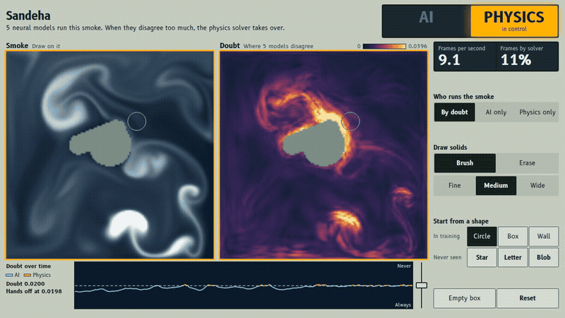

# Sandeha

Sandeha (Sanskrit for "doubt") is a neural 2D smoke simulator built to test one idea: run five networks, treat their disagreement as doubt, and call a conventional physics solver when doubt is high. **The idea did not work as hoped.** With the rules fixed in advance and the threshold frozen on validation, handing off by doubt did not beat a fixed or random schedule at the same solver budget on any test set. On unseen shapes it was worse than the fixed schedule, scoring 0.2881 against 0.2652, where lower is better. An oracle that hands off using the true error was no better than doubt on familiar scenes or unseen shapes. Other parts held, with limits. Doubt does track error at a given rollout time, but on unseen shapes a divergence signal with no ensemble scored higher, 0.676 [0.537, 0.755] against 0.522 [0.286, 0.673]. Those intervals overlap, and no paired interval was saved. The ensemble is about 13 to 17 times faster than this project's own reference solver, with all five members counted. It is more accurate than the coarse solver on familiar scenes and, inside the primary window, on unseen shapes, but not on either side of the out-of-range set. The main results are from a small project on generated 2D data, and it claims no new science. A separate test of doubt alone, on a published simulation benchmark with 9 test trajectories, gave a within-time Spearman of 0.820 [0.494, 0.910], against 0.186 [-0.221, 0.501] for the no-ensemble signal. That is a different flow, it has no hand-off, and it doesn't change the result above.



[Watch the 3-minute walkthrough](docs/assets/sandeha-walkthrough.mp4): the live demo, then the two main result charts. It has no audio.

The recording is of the real system, running live, and it includes physics-only mode. Two stills from it are `docs/assets/doubt-star.png` (by doubt, on a star) and `docs/assets/physics-mode.png` (physics only). Recording slows the demo: by-doubt and physics-only modes showed about 7 and 4 frames per second on screen (`docs/BUILD_LOG.md`). Those are readings with recording overhead, not benchmark figures. The demo is not evidence for any result below. The measured results are.

## Run the demo

You need [uv](https://docs.astral.sh/uv/) and an NVIDIA GPU with a driver that supports CUDA 13.2. This one command installs the project, downloads the trained weights and starts the demo:

```bash
uv sync && curl -fL https://github.com/Adwaith-R-Nair/sandeha/releases/download/v1.0/sandeha-weights.tar.gz | tar xz && uv run python scripts/run_demo.py
```

Then open `http://127.0.0.1:8000`. It needs no internet once the download has finished.

This was checked on a fresh clone at commit `9c4bac7`: the install worked, the weights unpacked, and the trained demo started and served the page.

The weights aren't in git. They are published as release `v1.0`, in the file `sandeha-weights.tar.gz`, which unpacks at the repo root and holds the five ensemble checkpoints and `data/normalizer.json`. The public-dataset checkpoints aren't in it. On start-up the demo checks each checkpoint against its SHA-256 in `results/ensemble.json`, and refuses to run on a mismatch.

Useful options for `scripts/run_demo.py`: `--device cpu` runs slowly on purpose, `--members 3` uses fewer members and shows that on the page, and `--port 8001` picks another port. `--random-weights` needs no download, and the page then says that the models are untrained and that nothing shown is a result.

## Key results

Every number here is copied from the named file in `results/`, and `docs/RESULTS.md` has the full analysis. A score is the mean per-frame error over frames 21 to 70, and lower is better. Intervals are 95% bootstrap intervals over whole scenes. `test_a` has new scenes like the training ones, `test_b` has unseen shapes, and `test_c` has buoyancy and inflow outside the training range, with 10 low-side and 20 high-side scenes. Each set is 30 scenes.

### Did doubt-based hand-off beat fixed and random schedules?

No. The rule, fixed in advance, was that doubt wins only if the whole interval of its difference lies below zero.

| Set | Doubt | Solver share | Fixed | Doubt less fixed | Random | Doubt less random | Doubt beats either? |
|---|---|---|---|---|---|---|---|
| `test_a` | 0.245 | 19.9% | 0.251 | -0.006 [-0.019, 0.009] | 0.255 | -0.011 [-0.025, 0.005] | No |
| `test_b` | 0.288 | 13.9% | **0.265** | **0.023 [0.004, 0.041]** | 0.277 | 0.011 [-0.005, 0.025] | No. Worse than fixed |
| `test_c` low | 0.219 | 0.0% | not run | | not run | | No hand-off happened, so nothing to compare |
| `test_c` high | 0.410 | 92.2% | 0.419 at 66.1%, 0.411 at 99.0% | -0.009 [-0.022, 0.006], -0.001 [-0.014, 0.013] | 0.418 | -0.008 [-0.022, 0.007] | No |

Source: `results/exp_handoff.json`.

### Was the oracle better?

The oracle hands off using the true error of the current frame, which nobody could do in practice. It was no better than doubt on `test_a` and `test_b`, so the weak link isn't only the doubt signal. It was ahead on the high side of `test_c`. These figures are descriptive.

| Set | Oracle | Solver share | Doubt less oracle |
|---|---|---|---|
| `test_a` | 0.245 | 19.5% | 0.000 [-0.006, 0.007] |
| `test_b` | 0.298 | 13.0% | -0.010 [-0.024, 0.002] |
| `test_c` high | 0.396 | 92.2% | 0.014 [0.002, 0.027] |

Source: `results/exp_handoff.json`.

### Speed and accuracy

| Set | Ensemble | Coarse 128×128 solver | Solver only | Ensemble ms per frame | Coarse ms per frame | Reference ms per frame |
|---|---|---|---|---|---|---|
| `test_a` | **0.256** [0.220, 0.292] | 0.346 [0.319, 0.373] | 0.097 | 15.2 | 178.8 | 262.8 |
| `test_b` | **0.308** [0.272, 0.345] | 0.369 [0.343, 0.398] | 0.098 | 14.9 | 180.2 | 192.4 |
| `test_c` low | 0.219 [0.194, 0.240] | **0.152** [0.139, 0.166] | 0.018 | 14.9 | 153.6 | 194.4 |
| `test_c` high | 0.526 [0.495, 0.563] | 0.516 [0.488, 0.544] | 0.278 | 14.9 | 183.0 | 194.4 |

Source: `results/exp_accuracy.json`. Bold marks the better of ensemble and coarse where the intervals don't clearly overlap. On `test_b` the two intervals touch, and at 100 frames the coarse solver is ahead.

- The reference timings give about 13 to 17 times faster. Against the longer solver-only runs it is about 13 to 15 times, so "about 14 times" is a fair single figure. The solver is this project's own PyTorch code, not tuned for speed, on one laptop GPU. A tuned solver could narrow the gap, but none was measured.
- Speed isn't free. Running the solver only scores 0.097 on `test_a` and 0.098 on `test_b`, far below the ensemble's error.
- Hand-off gives much of the speed back: 67.1 ms per frame on `test_b` under doubt. On the high side of `test_c` it took 257.7 ms, slower than the reference, and scored 0.410 where a continuous solver run scored 0.278.
- The demo ran in AI mode at 61.3 frames per second with all 5 members, against a target of 15 (`results/demo_bench.json`). That run had no solver frames, so it doesn't describe by-doubt or physics-only mode.

### Does doubt predict error?

Partly. It correlates with error at a given rollout time, but it didn't rise on unseen shapes.

| Set | Doubt, within-time Spearman | No-ensemble divergence signal, within-time Spearman | Chance of higher doubt than `test_a` |
|---|---|---|---|
| `test_a` | 0.671 [0.455, 0.796] | 0.621 [0.378, 0.755] | |
| `test_b` | 0.522 [0.286, 0.673] | 0.676 [0.537, 0.755] | 0.479 [0.335, 0.615] |
| `test_c` low | 0.403 [0.001, 0.709] | 0.669 [0.055, 0.968] | 0.103 [0.033, 0.194] |
| `test_c` high | 0.388 [0.042, 0.633] | 0.174 [-0.105, 0.436] | 0.968 [0.923, 0.996] |

Source: `results/exp_doubt.json`. The divergence of one network's output scored higher than doubt on `test_b`, and much lower on the high side of `test_c`. The two were scored on different rollouts, each against its own error, and no paired interval was saved. The divergence signal was never used for hand-off.

### Why hand-off fell short (post-hoc)

**This analysis is exploratory and wasn't preregistered.** It comes from the same test sets that showed the results, its intervals aren't corrected for the number of comparisons tried, and confirming it needs new data. It's in `results/posthoc_analysis.json`.

- The largest supported cause of the `test_b` loss is which scenes got the solver. 19 of 30 scenes got no hand-off in frames 21 to 70, and the top 5 scenes took 75% of solver frames.
- Doubt behaves mostly like a property of the scene, not a moment-by-moment alarm. After removing time, the share of log-doubt variance that is between scenes is about 90%, and 83% on the low side of `test_c`.
- Late hand-offs, the first guess after seeing the results and before the post-hoc analysis, explain little of the loss.
- Restarting the solver has a real cost. On the high side of `test_c`, a fixed schedule at 99% solver scored 0.411, while one continuous solver run scored 0.278.

### Public dataset: doubt on a published simulation benchmark

This track measures doubt only, with 3 members, in a single test run. It is a published simulation benchmark, not measured data, and it has only 9 test trajectories. It has no hand-off, because the project has no solver for that physics, so it says nothing about the hand-off result above.

| Frames | Doubt, within-time Spearman | No-ensemble divergence signal, within-time Spearman |
|---|---|---|
| 21 to 70, the primary window | 0.820 [0.494, 0.910] | 0.186 [-0.221, 0.501] |
| 21 to 100, secondary | 0.467 [0.142, 0.643] | -0.208 [-0.466, 0.059] |

Source: `results/exp_well.json`. Within-time AUROC has no value here, since 9 trajectories can't give the 5 bad and 5 good frames each time needs. Calibration isn't steady: the highest of ten doubt bins had a mean error of 0.583, against 1.115 for the bin below it.

On this flow doubt scored higher, where on `test_b` the divergence signal did, 0.676 against 0.522. This is a different flow, with different models and far fewer trajectories, so neither result carries to the other. The primary intervals overlap slightly, and no paired interval was saved. Each cooling time appears in one test trajectory and isn't an input to the models, so doubt may partly be sorting flows by cooling time. That wasn't tested. Details are in `docs/RESULTS.md`.

**Dataset and credit.** `turbulent_radiative_layer_2D`, from The Well (Ohana et al., *The Well: a Large-Scale Collection of Diverse Physics Simulations for Machine Learning*, NeurIPS 2024, arXiv:2412.00568). The dataset card asks for this citation: Fielding et al., *Multiphase Gas and the Fractal Nature of Radiative Turbulent Mixing Layers*, The Astrophysical Journal Letters 894(2), L24, 2020, DOI 10.3847/2041-8213/ab8d2c. The data licence is CC-BY-4.0. Dataset link: https://huggingface.co/datasets/polymathic-ai/turbulent_radiative_layer_2D. Full entries are in `docs/REFERENCES.md`.

## Repo map

| Path | What it holds |
|---|---|
| `src/sandeha/physics/` | The 2D smoke solver and scene sampling |
| `src/sandeha/data/` | Data generation, the test-set lock, the dataset and its checks |
| `src/sandeha/models/`, `src/sandeha/train/` | U-Net, FNO, losses and resumable training |
| `src/sandeha/ensemble.py`, `src/sandeha/hybrid.py` | Doubt, the hand-off and its policies |
| `src/sandeha/handoff_selection.py` | Choosing the threshold on validation |
| `src/sandeha/eval/` | Metrics, rollouts and the experiments |
| `src/sandeha/well/` | The public-dataset loader and the doubt measures |
| `src/sandeha/demo/` | The demo server and page |
| `scripts/` | A command for each job, from data generation to figures |
| `configs/` | Data, training and evaluation settings |
| `results/`, `results/figures/` | Every saved result and figure |
| `tests/` | The test suite, which mirrors `src/` |
| `docs/` | The documents listed below, and `docs/assets/` for the recording |
| `data/`, `runs/` | Datasets and checkpoints. Not in git |

## Other commands

```bash
uv run pytest                               # needs the GPU, as many tests name it directly
uv run python scripts/render_results.py     # rebuilds the generated block in docs/RESULTS.md
uv run python scripts/make_figures.py       # redraws the result figures from results/
```

The last recorded test run was on a fresh clone at commit `9c4bac7`: 573 passed and 1 skipped, leaving out `tests/data/test_travel.py`, which wasn't rerun there. That file was in the full run at `dd78b8d`, and it changed afterwards at `446d45f`. The final experiment ran once and must not be repeated, so regenerating results means regenerating from the saved files.

Long jobs run under a wrapper, which refuses to start without mains power, holds a sleep and lid inhibitor, and logs to `runs/<name>.log` and `runs/jobs.log`:

```bash
scripts/long_job.sh <name> <command...>
```

A `START` line with no `END` line in `runs/jobs.log` means the wrapper was killed or the machine died, and the job may still be running. Before restarting it, check that `systemd-inhibit --list` shows no `sandeha` entry for that job.

## Documents

| Document | What it covers |
|---|---|
| [RESULTS](docs/RESULTS.md) | Every result, weak ones included, with the analysis of why hand-off fell short |
| [REPORT](docs/REPORT.md) | Course report: methods, results, discussion, limits and references |
| [MODEL_CARD](docs/MODEL_CARD.md) | What the models are, and where not to trust them |
| [VIVA_GUIDE](docs/VIVA_GUIDE.md) | Concepts in plain language, hard questions and the demo script |
| [PREREGISTRATION](docs/PREREGISTRATION.md) | What was fixed before any data or model existed |
| [DESIGN](docs/DESIGN.md) | The design the project was built from |
| [PRD](docs/PRD.md) | Requirements and success measures, with their outcomes |
| [HLD](docs/HLD.md) | High-level design |
| [LLD](docs/LLD.md) | Low-level design |
| [PLAN](docs/PLAN.md) | The implementation plan |
| [TEST_PLAN](docs/TEST_PLAN.md) | What is tested, and how |
| [DECISIONS](docs/DECISIONS.md) | Each decision, with the alternatives and reasons |
| [BUILD_LOG](docs/BUILD_LOG.md) | What was built and measured, in order |
| [REFERENCES](docs/REFERENCES.md) | Sources, checked against the originals |
