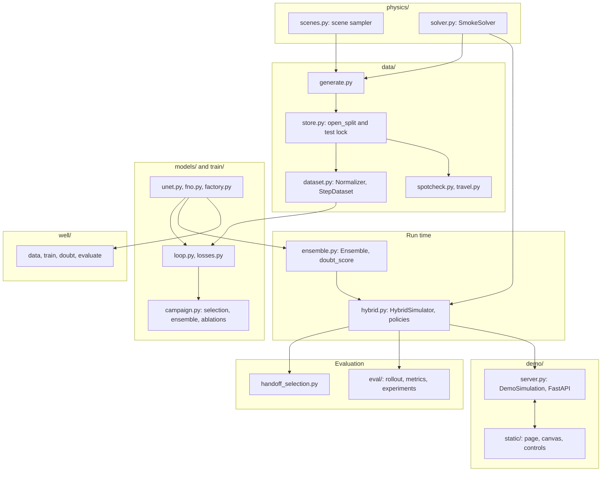
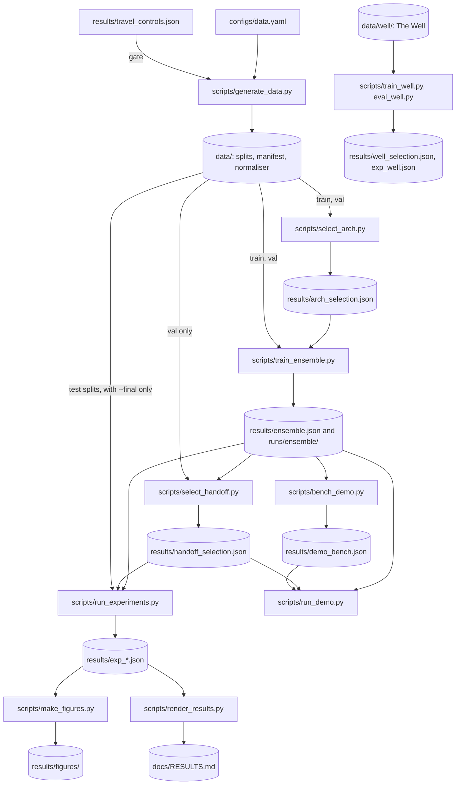
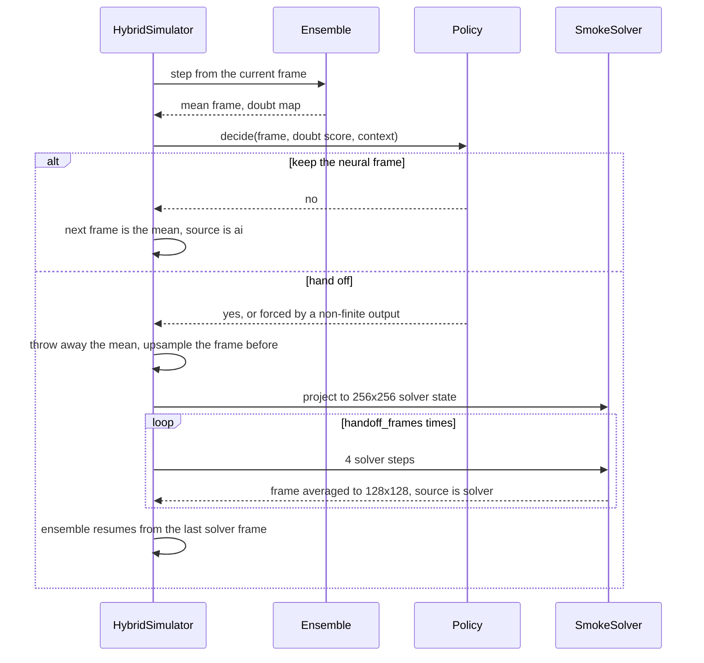

# Sandeha: High-Level Design

**Status:** the code under `src/sandeha/`, `scripts/` and `configs/` is built, including the demo. The dataset, ensemble and final experiment are complete; see `docs/RESULTS.md`.

Details are in `LLD.md`, tests in `TEST_PLAN.md`, reasons in `DECISIONS.md`, and experiment rules in `PREREGISTRATION.md`.

## System overview

Sandeha is a 2D smoke simulator. Its question: does the disagreement of an ensemble of neural models predict their error, and what does handing off to a physics solver cost and gain?

- A GPU solver makes the reference data at 256×256, stored at 128×128.
- Neural models learn one 128×128 step, equal to 4 solver steps.
- An ensemble of them gives a mean frame and a doubt map, which is where the members disagree.
- A hybrid simulator asks a policy, each frame, whether to keep the neural frame or hand the whole frame to the solver.
- Experiments compare that against baselines on locked test sets. A browser demo runs the same hybrid simulator live.

## Components

| Component | Responsibility | Location |
|---|---|---|
| Reference solver | Staggered-grid smoke: advection, buoyancy, obstacles, pressure projection | `src/sandeha/physics/solver.py` |
| Scene sampler | Random scenes per split, with shape families and physics ranges | `src/sandeha/physics/scenes.py` |
| Data generation | Runs scenes in batches, resumes after a stop, writes the manifest | `src/sandeha/data/generate.py` |
| Data store | Reads the files, checks checksums, locks test splits | `src/sandeha/data/store.py` |
| Dataset | Normaliser fitted on train only, training items | `src/sandeha/data/dataset.py` |
| Data checks | Spot-check after generation, and the rule for fast flows over thin walls | `src/sandeha/data/spotcheck.py`, `travel.py` |
| Models | U-Net, FNO, one step with solids forced to zero | `src/sandeha/models/` |
| Training | Loss, pushforward, atomic checkpoints, resume, time budget | `src/sandeha/train/loop.py`, `losses.py` |
| Training runs | Architecture selection, ensemble with member checks, ablations | `src/sandeha/train/campaign.py` |
| Ensemble | Step from a shared input, doubt map, doubt score | `src/sandeha/ensemble.py` |
| Hybrid | Policies and whole-frame hand-off | `src/sandeha/hybrid.py` |
| Hand-off selection | Aggregation, hand-off length and threshold, on validation only | `src/sandeha/handoff_selection.py` |
| Evaluation | Rollouts, baselines, metrics, the four experiments | `src/sandeha/eval/` |
| Public track | Doubt only on a published benchmark, with no hand-off | `src/sandeha/well/` |
| Demo | Simulation thread, WebSocket server, browser page | `src/sandeha/demo/` |
| Long-job wrapper | Mains check, sleep and lid inhibitor, job log | `scripts/long_job.sh` |
| Reports | Figures and the generated block of `RESULTS.md`, from saved JSON | `scripts/make_figures.py`, `render_results.py` |

## Data flow

1. Scenes are sampled per split from seeds that depend only on the master seed, the split and the scene number. They run at 256×256 for 121 frames.
2. Frames are averaged down to 128×128 and written one scene at a time, atomically. The manifest goes last, with seeds, config, commit and a SHA-256 for each file. A copy is tracked as `results/data_manifest.json`.
3. Training reads `train`, and tuning reads `val`. A test split opens only with `final_eval=True`.
4. U-Net and FNO each train once from seed 0. The lower validation rollout error wins, and the winner trains from 5 seeds. Each member must pass a check, or it is retrained once from a new seed.
5. The aggregation, hand-off length and threshold are chosen on validation, and committed before any test split opens.
6. `run_experiments.py --final` measures accuracy, doubt, hand-off and ablations, and writes JSON with provenance. Figures and `RESULTS.md` come from that JSON only.

### One simulator step

## Key design choices

Reasons and alternatives are in `DECISIONS.md`.

- **Targets come from a finer grid than the model runs on.** A solver at 128×128 is itself fast, so the neural model is compared with it and with the 256×256 reference. Whether the model is better than either is for the experiments to say.
- **Members step from the shared mean.** Every member gets the same input at each step, so the doubt map measures one step's disagreement, and members don't drift apart over a rollout. Independent rollouts are kept as a secondary comparison.
- **The hand-off takes the whole frame.** Per-region hand-off is out of scope for the first version.
- **The ensemble runs every step, even when the solver takes the frame.** The policy needs its output, and all timing includes every member.
- **Test sets are locked, and choices are frozen on validation.** The rules were written before any model existed, in `PREREGISTRATION.md`.
- **A blow-up is never dropped.** It counts at the error cap of 10 and stays in every average.

## Demo

`scripts/run_demo.py` runs a Python server on localhost with all front-end assets served locally, including fonts. One thread runs the simulation whether or not a browser is connected, and the WebSocket sends each client the newest frame.

The page shows smoke and doubt side by side, a doubt trace with the threshold, frames per second, the share of frames made by the solver, and who is in control. The user can draw and erase solids, load presets including shapes never seen in training, reset, move the threshold, and force AI-only or physics-only mode.

With `--random-weights`, the demo runs untrained models and the page says so. Nothing shown in that mode is a result.

## Results that exist so far

Figures quoted in these documents come from these four files. None of them measures the ensemble.

| File | What it says |
|---|---|
| `results/arch_selection.json` | `"winner": "unet"` on `val`. `val_error` is `0.09147062503461105` for the U-Net and `0.12584704872143143` for the FNO, with `persistence_error` `0.6689278872931997`. These are single models from seed 0 |
| `results/throughput.json` | Training speed and memory for both models at batch 8, 16 and 32. Figures are in `LLD.md` |
| `results/spot_check.json` | `"passed": true`, with `non_finite_values` of `0` in all 5 splits |
| `results/solver_check.json` | Solver speed, grid convergence and long-run divergence. Figures are in `LLD.md` |

## Deployment

Everything runs locally on one laptop: Ubuntu 26.04, RTX 3060 Laptop GPU (6 GB), Python 3.12 through `uv`. Long jobs run under `scripts/long_job.sh`. Datasets, runs and checkpoints are not tracked.

## Risks and responses

| Risk | Response in the code |
|---|---|
| Laptop sleeps, loses power or is stopped | Long-job wrapper. Training, generation, selection and experiments all restart from where they stopped |
| FNO fails for practical reasons | `select_architecture` records the failure and goes on with the U-Net |
| A member blows up or doesn't beat persistence | `train_ensemble` retrains it once with 100 added to its seed. A second failure leaves the ensemble marked not complete |
| Ensemble training too slow | `train_ensemble.py --seeds 0 1 2`, with the change recorded |
| Demo below 15 frames per second | `bench_demo.py` steps down from 5 to 2 members. The demo uses that count and shows it on screen |
| User seals the box, fills it or breaks the state | The demo returns to the last finite frame with a hand-off, or to empty fields with the same solids if that fails |
| Solver doesn't converge | Reported in `last_solve`, counted in the manifest, and not raised |
