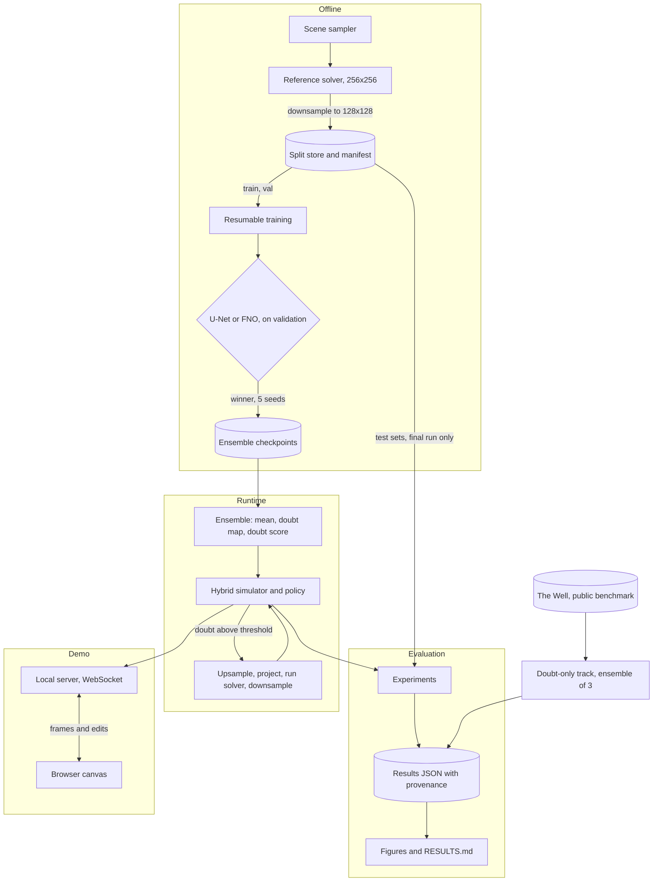

# Sandeha: High-Level Design

**Status:** planned architecture. Only the project foundation exists so far. This document is updated as components are built.

## System overview

A GPU solver produces fine-grid truth. Neural models learn one coarse step from that truth, and an ensemble of them turns disagreement into a doubt signal. A hybrid simulator uses the signal to choose between the neural models and the solver. Experiments measure the result, and a local server drives the browser demo.

## Components

| Component | Responsibility | Location |
|---|---|---|
| Reference solver | Source of truth: advection, buoyancy, obstacles, pressure projection | `src/sandeha/physics/solver.py` |
| Scene sampler | Random scenes per split, with shape families and physics ranges | `src/sandeha/physics/scenes.py` |
| Data store | On-disk format, manifest with checksums, guard on test splits | `src/sandeha/data/store.py` |
| Dataset | Normaliser fitted on train only, training items | `src/sandeha/data/dataset.py` |
| Models | U-Net, FNO, factory | `src/sandeha/models/` |
| Training | Losses, pushforward rollouts, atomic checkpoints, resume | `src/sandeha/train/` |
| Ensemble | Shared-mean stepping, doubt map, doubt score | `src/sandeha/ensemble.py` |
| Hybrid | Hand-off logic and policies | `src/sandeha/hybrid.py` |
| Evaluation | Metrics, rollouts, timing, experiments | `src/sandeha/eval/` |
| Public track | Loader for the public benchmark | `src/sandeha/well/` |
| Demo | Simulation loop, WebSocket server, front end | `src/sandeha/demo/` |
| Long-job wrapper | Mains check, sleep and lid inhibitor, job log | `scripts/long_job.sh` |

## Data flow

1. Scenes are sampled per split with disjoint seeds, and simulated at 256×256.
2. Frames are downsampled to 128×128 and written atomically per scene. A manifest records seeds, config, git commit and SHA-256 of each split.
3. Training reads `train`, and all tuning reads `val`. Test sets open only with `final_eval=True`.
4. Each neural step takes velocity, density, obstacle, inflow and buoyancy, and predicts the change over 4 solver steps.
5. At each step, every ensemble member starts from the shared ensemble mean. The doubt map is the disagreement between them.
6. When a policy decides to hand off, the state is upsampled to 256×256 and projected. The solver runs for a set number of frames, its result is downsampled, and the neural model resumes.
7. Experiments write JSON carrying git commit, data manifest hash, checkpoint hashes and config. Figures and `RESULTS.md` are generated from that JSON.

## Key design choices

Reasons and alternatives are in `DECISIONS.md`. The most consequential are:

- **Training targets come from a finer grid than the neural model runs on,** so that the model can offer fine-grid accuracy at coarse-grid cost. A solver at 128×128 is itself fast, so beating it on speed alone proves nothing.
- **Members step from the shared mean,** so that doubt reflects the current flow and does not simply grow with rollout time.
- **Whole-frame hand-off,** because per-region hand-off carries much more risk for the first version.
- **Test sets are locked before any model exists,** and thresholds are frozen on validation.

## Deployment

Everything runs locally on one laptop: Ubuntu 26.04, RTX 3060 Laptop GPU (6 GB), Python 3.12 through `uv`. The demo is a Python server on localhost, with all front-end assets served locally. Long jobs run under `scripts/long_job.sh`.

## Risks and responses

| Risk | Response |
|---|---|
| 128×128 too heavy or too slow | Drop to 96×96 |
| Rollouts unstable | Stronger rollout training, or a larger neural step |
| Ensemble training too slow | Ensemble of 3 |
| Demo under target frame rate | Fewer members in the demo, disclosed on screen |
| FNO fails for practical reasons | Record why and continue with U-Net |
| Laptop sleeps, loses power or throttles | Long-job wrapper, resumable training, GPU temperature and memory watched |
